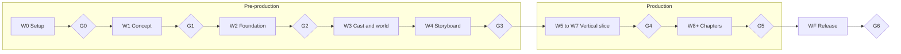
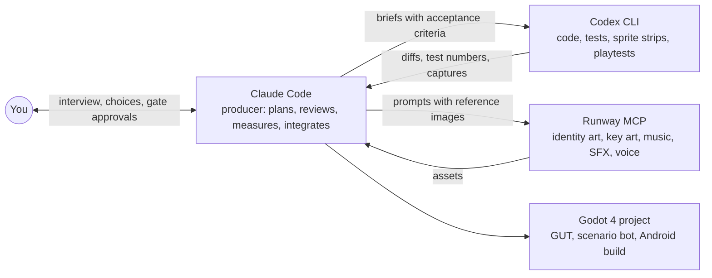

# claude-game-factory

[](https://skills.sh/Hessel-It-Solutions/claude-game-factory)
[](LICENSE)
[](plugins/game-factory/.claude-plugin/plugin.json)
[](https://github.com/Hessel-It-Solutions/claude-game-factory/discussions)

A game studio packaged as a Claude Code plugin. You bring the idea and approve each stage; the factory runs pre-production, art, audio, Godot code, tests and blind playtests until you have a pixel-art mobile game running on a phone.

It is made of one producer command and 25 specialist skills, plus the tools they use. Claude Code is the producer. Codex CLI does most of the code and the sprite strips. Runway makes the identity art, key art, music and sound. Godot 4 is the engine. The skills reply in your language, and the games they make can ship in several (the first one is in English, Portuguese and Spanish).


## Is it for you?

It fits if you want to make a 2D pixel-art game for phones with Godot 4, and you are happy to act as the director: answer the interview, pick between options, approve each gate, play the builds. You do not need to write the code or draw the sprites yourself.

It does not fit if you want 3D, Unity or Unreal, or a finished game from one prompt. A chapter takes weeks of rounds, not minutes.

## Built with it: David: Rise of a King

The factory came out of making *David: Rise of a King*, a top-down action RPG about David, from shepherd boy to king, for Android and iOS. The first 23 days went from an empty folder to a playable chapter 1 on Android: 92 commits, about 3,200 Runway credits, 743 GUT tests, a bot that plays the chapter end to end, and 17 rounds of UX fixes driven by blind playtests.

| Storyboard frame | The same idea in game |
|---|---|
|  |  |
|   |   |


More screenshots, animations, the blind playtest flipbook, music and sound effects are in the [showcase](showcase/david-rise-of-a-king/README.md). The game is still in development; chapter 1 is in playtest.

## What a session looks like

An abridged example. The numbers come from the David project: wave W3 (cast and world for the pilot chapters) and blind playtest round 13.

```text
> /game-factory:game-factory next

W3 Cast and world (pilot), feeds G3
  gf-characters   sonnet   character sheets, identity bases and portraits
  gf-world        sonnet   location sheets and key art
  gf-narrative    opus     script for the pilot chapters
  gf-game-design  opus     content plan
  Codex                    33 concepts and turnarounds (subscription, no credits)

Estimate: about 700 Runway credits (cap 850). This is above 300, so I need your approval.
Approve W3? (yes / change something / no)

> yes

... agents run in parallel, each writing only to its own files ...

W3 done. Spent 701 credits, balance 3,253. Identity bases, portraits and key art
are ready for review in art/, with the open questions from the agents listed for you.
Next: W4 Storyboard, then gate G3.
```

After the vertical slice, most of the work is the chapter loop. Same project, a later round:

```text
> run a blind playtest of chapter 1, then plan the fixes

The tester played 46 minutes and reached the boss. 5 friction points, ranked.
Fix plan: 3 Codex batches in parallel clones, 0 Runway credits, Codex quota only.
Approve?
```

## What you need

| | Needed for | Required? |
|---|---|---|
| [Claude Code](https://claude.com/claude-code) | runs the producer and the skills | yes (or another agent, see below) |
| [Godot 4](https://godotengine.org) with export templates | the game | yes |
| Python 3.11+, ffmpeg | the tools | yes |
| [Codex CLI](https://github.com/openai/codex) with a ChatGPT plan | code and sprite strips without spending Claude tokens | strongly recommended |
| [Runway](https://runwayml.com) connected as an MCP server | identity art, key art, music, SFX, voice | recommended |
| Android SDK, JDK 17, an emulator | builds and blind playtests | from the vertical slice on |

Cost is real. Pre-production plus chapter 1 of the first game used about 3,200 Runway credits, plus a large share of Claude and Codex quota. The producer shows an estimate in credits and tokens before every wave and waits for approval above the threshold. You can run pre-production up to gate G2 with Claude alone.

## Quick start

### Claude Code (recommended: full plugin)

```text
/plugin marketplace add Hessel-It-Solutions/claude-game-factory
/plugin install game-factory@hessel
```

Then, in an empty folder:

```text
/game-factory:game-factory new my_game
```

The producer sets up the toolchain (W0), interviews you about the game (W1), and from there you advance with:

```text
/game-factory:game-factory next
```

### Other agents (Cursor, Codex, Gemini, OpenCode and others)

The skills are also listed on [skills.sh](https://skills.sh/Hessel-It-Solutions/claude-game-factory):

```sh
npx skills add Hessel-It-Solutions/claude-game-factory
```

This installs the 25 skills without the producer command. Ask in plain words instead, for example "start a new game called my_game with the game factory", then "plan the next wave". The `gf-setup` skill downloads the tools and templates from this repository during W0.

The full walkthrough, with every command, is in [docs/getting-started.md](docs/getting-started.md).

## How it works

Work runs in waves with approval gates in between. Pre-production produces a bible in `docs/` (concept, GDD, script, art direction, cast, world, storyboard). Production does not start until you approve the bible at gate G3.



Inside each wave the work is split by who does it best:



Each skill owns specific files and writes only there, so several agents can work in parallel without conflicts. Every generated asset is registered with its prompt, model, task id and cost. Every visual delivery is compared side by side with its storyboard frame at game scale, and redone if it falls short.

Details: [docs/how-it-works.md](docs/how-it-works.md).

### The skills

| Group | Skills |
|---|---|
| Producer | `gf-producer`, `gf-setup` |
| Pre-production | `gf-concept`, `gf-game-design`, `gf-narrative`, `gf-world`, `gf-characters`, `gf-art-direction`, `gf-storyboard` |
| Art and audio | `gf-runway`, `gf-sprites`, `gf-environments`, `gf-ui`, `gf-audio` |
| Godot | `gf-godot-core`, `gf-gameplay`, `gf-levels`, `gf-cutscenes`, `gf-mobile` |
| Quality | `gf-autotest`, `gf-qa`, `gf-playtester`, `gf-rpg-review`, `gf-continuity` |
| Release | `gf-release` |

### The tools

| Tool | What it does |
|---|---|
| `gf` CLI | Palette post-processing and validation, sheet cutting, review boards, subagent context packs, asset registry, budget log, state updates, mechanical continuity checks |
| `strip_rescale.py`, `build_sprite_atlas.py` | Turn raw sprite-gen strips into consistent frames and a Godot-ready atlas |
| `tools/codex/batch_launch.sh` | Run a Codex batch in an isolated clone of the project, so several batches run in parallel |
| `tools/playtest/` | Blind playtest kit for the Android emulator: screenshot, input bursts, tester prompt, journal format |
| `game/tools/*.gd` | Collision dump, windowed scene capture, input-only scenario bot template |

## Claude Code, Codex and Runway together

The short version: Claude plans, reviews and integrates; Codex executes; Runway generates art and audio. Every wave shows an estimate of Runway credits, Claude tokens and Codex tokens before it runs.

The long version, including everything Codex got wrong and the checklist we use to catch it, is in [docs/ai-stack.md](docs/ai-stack.md).

## What we learned

Making a real game with this surfaced a long list of traps: AI-redrawn characters that lose their identity, Godot 4 quirks that only show on Android, green test suites over a broken UI, a blind tester that died from its own adb latency. They are collected in [docs/lessons-learned.md](docs/lessons-learned.md) and baked into the skills.

## Repository layout

```text
.claude-plugin/marketplace.json   marketplace entry (this repo is its own marketplace)
skills.sh.json                    sections of the skills.sh page
plugins/game-factory/             the plugin
  commands/game-factory.md        the producer command
  skills/gf-*/SKILL.md            the 25 skills
  tools/                          tools copied into each game at W0
  templates/                      STATE, DECISIONS, BUDGET, ASSETS, wave plan, Codex brief, handoff
docs/                             guides and lessons learned
showcase/david-rise-of-a-king/    screenshots, GIFs and audio from the first game (all rights reserved)
```

## Status and roadmap

Early (0.1.x), extracted from one real project. Expect rough edges.

- Tested on macOS (Apple Silicon) with Godot 4.7 and Android.
- Opinionated toward 2D pixel art, top-down, mobile, Godot 4.
- Runway and Codex are optional, but without them a lot of the art and code work falls back to Claude, which costs more tokens.

Next, and good places to start contributing:

- [Ship an iOS build end to end](https://github.com/Hessel-It-Solutions/claude-game-factory/issues/4)
- [Linux: verify gf-setup and the tools](https://github.com/Hessel-It-Solutions/claude-game-factory/issues/5) (good first issue)
- [Windows support](https://github.com/Hessel-It-Solutions/claude-game-factory/issues/6)
- [Turn lessons learned into automated checks](https://github.com/Hessel-It-Solutions/claude-game-factory/issues/7) (good first issue)
- [A small example game with MIT assets](https://github.com/Hessel-It-Solutions/claude-game-factory/issues/8)
- [Side-scroller and other genres](https://github.com/Hessel-It-Solutions/claude-game-factory/issues/9)
- [Other art and audio providers besides Runway](https://github.com/Hessel-It-Solutions/claude-game-factory/issues/10)

All open items are on the [roadmap label](https://github.com/Hessel-It-Solutions/claude-game-factory/issues?q=is%3Aissue+is%3Aopen+label%3Aroadmap).

## Contributing

Contributions are welcome, especially lessons from your own game, support for other platforms and genres, and fixes to the tools. Read [CONTRIBUTING.md](CONTRIBUTING.md) first. Questions, ideas and games made with the factory go to [Discussions](https://github.com/Hessel-It-Solutions/claude-game-factory/discussions). Security issues follow [SECURITY.md](SECURITY.md).

## Built on

- [Godot Engine](https://godotengine.org) and [GUT](https://github.com/bitwes/Gut) for the game and its tests.
- [sprite-gen](https://github.com/aldegad/sprite-gen) by aldegad, which generates and extracts the sprite strips.
- [Claude Code](https://claude.com/claude-code), [Codex CLI](https://github.com/openai/codex) and [Runway](https://runwayml.com).
- The first game uses the [Inter](https://rsms.me/inter/) and [Pixelify Sans](https://fonts.google.com/specimen/Pixelify+Sans) fonts (SIL Open Font License).

## License

The framework (plugin, skills, tools, docs, templates) is [MIT](LICENSE).

Everything in `showcase/` belongs to *David: Rise of a King* and is © Hessel IT Solutions, all rights reserved. It is here as an example only and is not covered by the MIT license. See [showcase/david-rise-of-a-king/LICENSE.md](showcase/david-rise-of-a-king/LICENSE.md).
