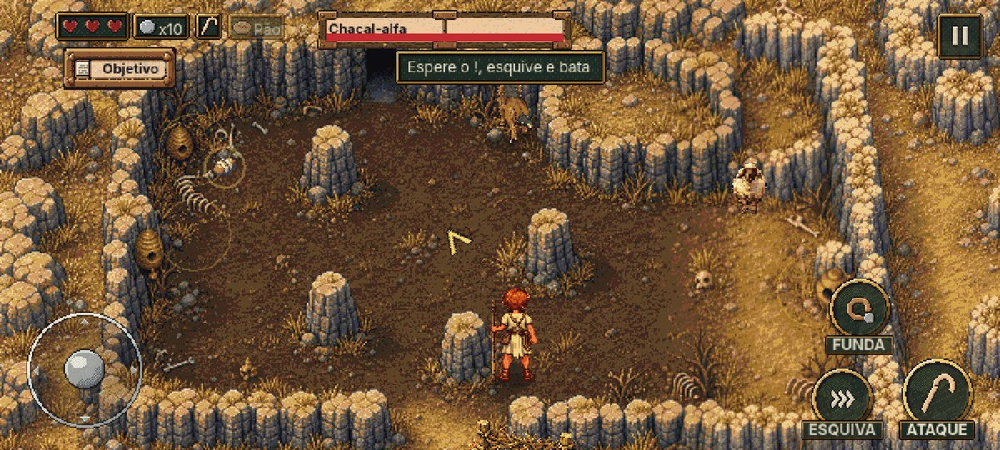
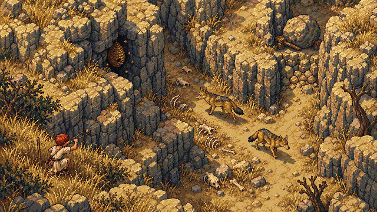
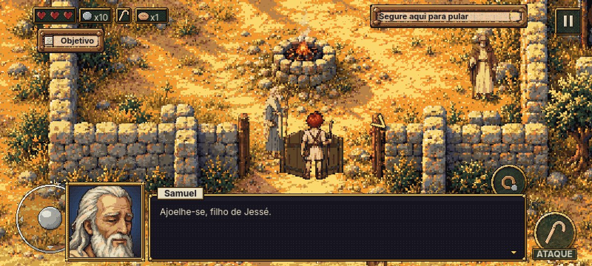
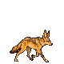
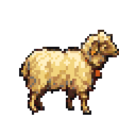
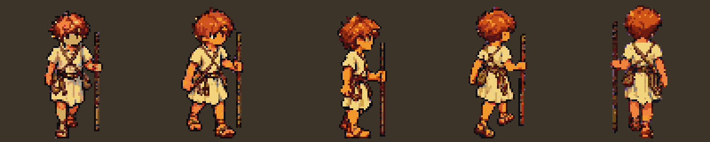

# claude-game-factory

A game studio packaged as a Claude Code plugin. You bring the idea and approve each stage; the factory runs pre-production, art, audio, Godot code, tests and blind playtests until you have a pixel-art mobile game running on a phone.

It is made of one producer command and 25 specialist skills, plus the tools they use. Claude Code is the producer. Codex CLI does most of the code and the sprite strips. Runway makes the identity art, key art, music and sound. Godot 4 is the engine.



## Built with it: David: Rise of a King

The factory came out of making *David: Rise of a King*, a top-down action RPG about David, from shepherd boy to king, for Android and iOS. The first 23 days went from an empty folder to a playable chapter 1 on Android: 92 commits, about 3,200 Runway credits, 743 GUT tests, a bot that plays the chapter end to end, and 17 rounds of UX fixes driven by blind playtests.

| Storyboard frame | In game | Sprites |
|---|---|---|
|  |  |   |



More screenshots, animations, the blind playtest flipbook, music and sound effects are in the [showcase](showcase/david-rise-of-a-king/README.md). The game is still in development; chapter 1 is in playtest.

## Quick start

```text
/plugin marketplace add Hessel-It-Solutions/claude-game-factory
/plugin install game-factory@hessel
```

Then, in an empty folder:

```text
/game-factory:game-factory new my_game
```

The producer sets up the toolchain (W0), interviews you about the game (W1), and from there you advance with:

```text
/game-factory:game-factory next
```

The full walkthrough, with requirements and every command, is in [docs/getting-started.md](docs/getting-started.md).

## How it works

Work runs in waves with approval gates in between. Pre-production (concept, GDD, script, art direction, cast, world, storyboard) produces a bible in `docs/`. Production does not start until you approve the bible at gate G3.

```text
W0 Setup ─ G0 ─ W1 Concept ─ G1 ─ W2 Foundation ─ G2 ─ W3 Cast & world ─ W4 Storyboard ─ G3
   ─ W5..W7 Vertical slice ─ G4 ─ W8+ Chapters ─ G5 ─ WF Release ─ G6
```

Each skill owns specific files and writes only there, so several agents can work in parallel without conflicts. Every generated asset is registered with its prompt, model, task id and cost. Every visual delivery is compared side by side with its storyboard frame at game scale, and redone if it falls short.

Details: [docs/how-it-works.md](docs/how-it-works.md).

### The skills

| Group | Skills |
|---|---|
| Producer | `gf-producer`, `gf-setup` |
| Pre-production | `gf-concept`, `gf-game-design`, `gf-narrative`, `gf-world`, `gf-characters`, `gf-art-direction`, `gf-storyboard` |
| Art and audio | `gf-runway`, `gf-sprites`, `gf-environments`, `gf-ui`, `gf-audio` |
| Godot | `gf-godot-core`, `gf-gameplay`, `gf-levels`, `gf-cutscenes`, `gf-mobile` |
| Quality | `gf-autotest`, `gf-qa`, `gf-playtester`, `gf-rpg-review`, `gf-continuity` |
| Release | `gf-release` |

### The tools

| Tool | What it does |
|---|---|
| `gf` CLI | Palette post-processing and validation, sheet cutting, review boards, subagent context packs, asset registry, budget log, state updates, mechanical continuity checks |
| `strip_rescale.py`, `build_sprite_atlas.py` | Turn raw sprite-gen strips into consistent frames and a Godot-ready atlas |
| `tools/codex/batch_launch.sh` | Run a Codex batch in an isolated clone of the project, so several batches run in parallel |
| `tools/playtest/` | Blind playtest kit for the Android emulator: screenshot, input bursts, tester prompt, journal format |
| `game/tools/*.gd` | Collision dump, windowed scene capture, input-only scenario bot template |

## Claude Code, Codex and Runway together

The short version: Claude plans, reviews and integrates; Codex executes; Runway generates art and audio. Every wave shows an estimate of Runway credits, Claude tokens and Codex tokens before it runs.

The long version, including everything Codex got wrong and the checklist we use to catch it, is in [docs/ai-stack.md](docs/ai-stack.md).

## What we learned

Making a real game with this surfaced a long list of traps: AI-redrawn characters that lose their identity, Godot 4 quirks that only show on Android, green test suites over a broken UI, a blind tester that died from its own adb latency. They are collected in [docs/lessons-learned.md](docs/lessons-learned.md) and baked into the skills.

## Repository layout

```text
.claude-plugin/marketplace.json     marketplace entry (this repo is its own marketplace)
plugins/game-factory/        the plugin
  commands/game-factory.md          the producer command
  skills/gf-*/SKILL.md              the 25 skills
  tools/                            tools copied into each game at W0
  templates/                        production file templates (STATE, DECISIONS, BUDGET, ASSETS, wave plan, Codex brief, handoff)
docs/                               guides and lessons learned
showcase/david-rise-of-a-king/      screenshots, GIFs and audio from the first game (all rights reserved)
```

## Status and limits

This is version 0.1, extracted from one real project. Expect rough edges.

- Tested on macOS (Apple Silicon) with Godot 4.7 and Android. iOS export is described in `gf-mobile` but has not shipped yet. Linux should work with small path changes. Windows is untested.
- Opinionated toward 2D pixel art, top-down or side view, mobile, Godot 4.
- Runway and Codex are optional, but without them a lot of the art and code work falls back to Claude, which costs more tokens.
- Cost is real. Pre-production plus chapter 1 of the first game used about 3,200 Runway credits, plus a large amount of Claude and Codex quota. The producer always shows estimates first.

## Contributing

Contributions are welcome, especially lessons from your own game, support for other engines and platforms, and fixes to the tools. Read [CONTRIBUTING.md](CONTRIBUTING.md) first.

## License

The framework (plugin, skills, tools, docs, templates) is [MIT](LICENSE).

Everything in `showcase/` belongs to *David: Rise of a King* and is © Hessel IT Solutions, all rights reserved. It is here as an example only and is not covered by the MIT license. See [showcase/david-rise-of-a-king/LICENSE.md](showcase/david-rise-of-a-king/LICENSE.md).
