# Showcase: David: Rise of a King

*David: Rise of a King* is the first game built with the factory. It is a top-down action RPG in pixel art (think *A Link to the Past*) that follows David from shepherd boy to king, for Android and iOS, in English, Brazilian Portuguese and Spanish. Chapter 1 is playable on a phone and is going through blind playtest rounds right now.

The UI in the screenshots is in Portuguese because the latest playtests ran in PT-BR.

> All files in this folder are © Hessel IT Solutions, all rights reserved. See [LICENSE.md](LICENSE.md). They are here as examples only.

## Pipeline, from style tile to the game

| Style tile (W1, Runway) | Storyboard frame (W4) | The same den, in game (W8+) |
|---|---|---|
| 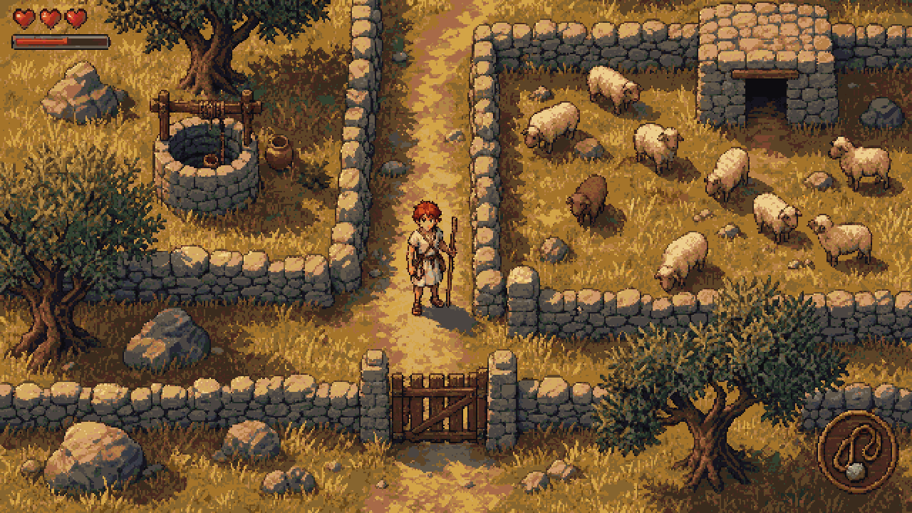 |  |  |

The storyboard is the bar. Every visual delivery is compared side by side with its frame at game scale, and anything below it gets redone before it goes into the game.

| Cast portraits | Key illustration (Runway) |
|---|---|
| 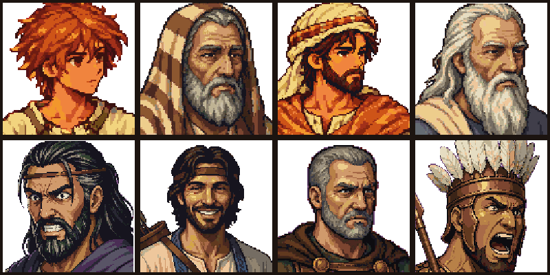 | 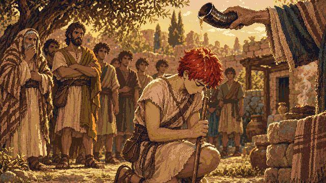 |

## In game

| | |
|---|---|
| 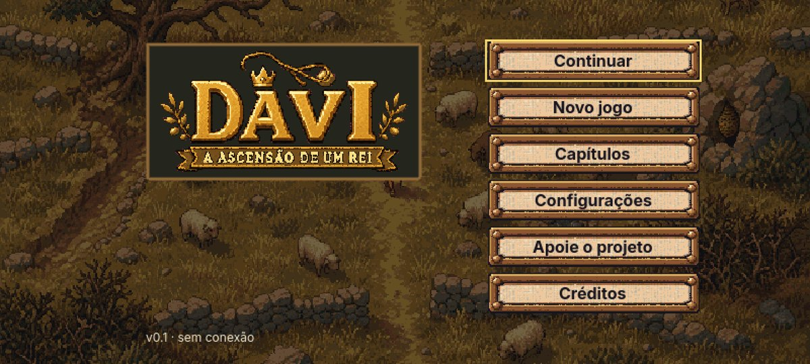 | 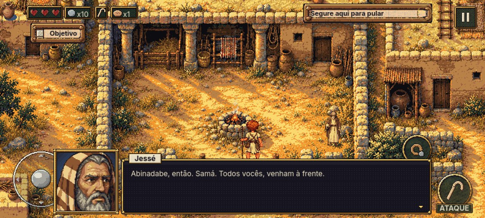 |
|  | 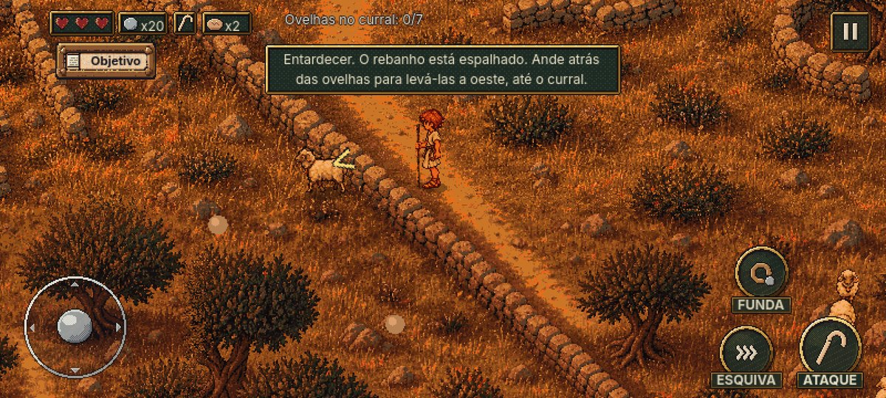 |
| 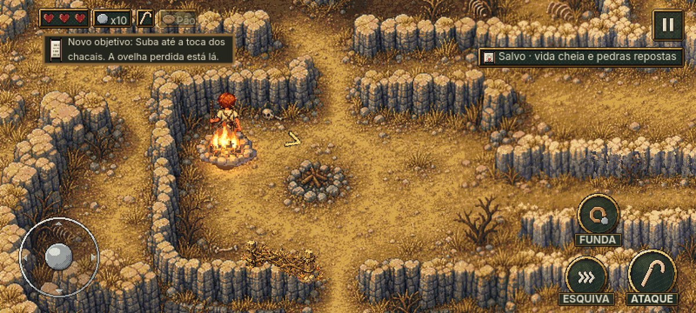 | 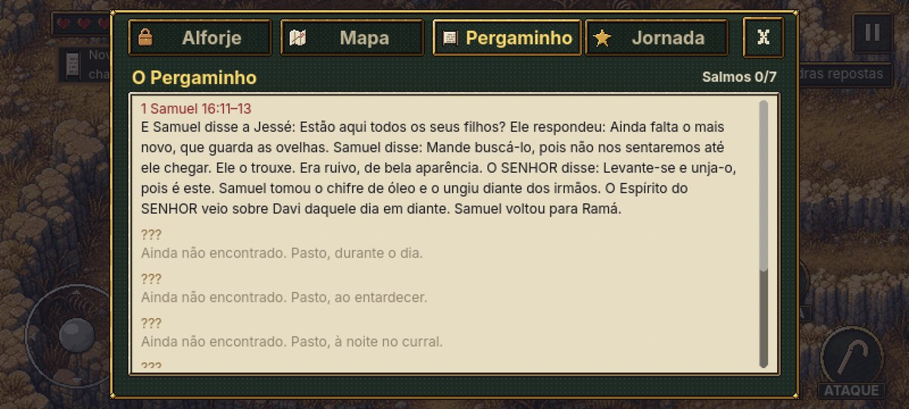 |

## Animation

The hero's walk cycle in five directions (the other three are mirrors). The pose strips came from Codex through sprite-gen, anchored on a base cut out of the storyboard; the atlas came from `tools/gf/build_sprite_atlas.py`.

| Jackal run | Jackal bite | Alpha idle | Sheep walk | Sheep graze |
|---|---|---|---|---|
|  | 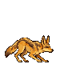 | 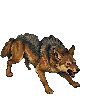 |  | 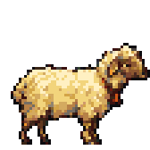 |

### A blind playtest, frame by frame

These are the screenshots a blind tester (a Claude subagent that had never seen the game, the code or the docs) took while fighting the chapter 1 boss on the Android emulator. It only sees these images and only taps the screen. Its diary and friction list drive the next UX round.

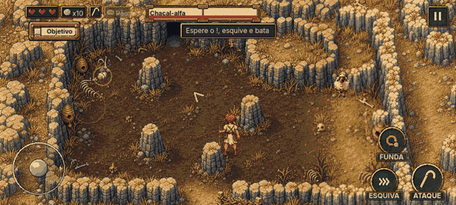

## Audio

All music and sound effects were generated with Runway and imported into Godot by the `gf-audio` skill. GitHub does not play audio inline, so click a file to open it and use the player or download it.

| Track | What it is |
|---|---|
| [music_title.mp3](audio/music_title.mp3) | Title screen (40 s excerpt) |
| [music_hero_theme.mp3](audio/music_hero_theme.mp3) | Hero theme, pasture by day (40 s excerpt) |
| [music_combat.mp3](audio/music_combat.mp3) | Combat with wild animals (30 s excerpt) |
| [stinger_victory.mp3](audio/stinger_victory.mp3) | Victory stinger |
| [sfx_sling_spin.mp3](audio/sfx_sling_spin.mp3), [sfx_sling_release.mp3](audio/sfx_sling_release.mp3), [sfx_stone_common_hit_flesh.mp3](audio/sfx_stone_common_hit_flesh.mp3) | Sling |
| [sfx_jackal_alpha_howl.mp3](audio/sfx_jackal_alpha_howl.mp3), [sfx_sheep_bleat.mp3](audio/sfx_sheep_bleat.mp3) | Animals |
| [sfx_dodge_perfect.mp3](audio/sfx_dodge_perfect.mp3), [sfx_ui_item_get.mp3](audio/sfx_ui_item_get.mp3), [sfx_ui_secret.mp3](audio/sfx_ui_secret.mp3) | Feedback and UI |

## Numbers so far (first 23 days)

- 92 commits from an empty folder to a playable chapter 1 on Android.
- About 3,200 Runway credits spent, wave by wave, every one estimated and approved before generating.
- 743 GUT tests and a scenario bot that plays chapter 1 from start to end with real input, checking 36 invariants across 6 seeds.
- 17 UX rounds, each one driven by a blind playtest on the emulator.
